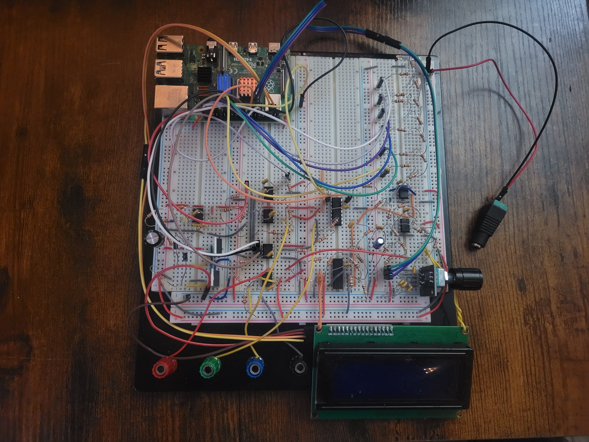

# Electronic Test Bench (ETB)

A Raspberry Pi 4 bench instrument built for ECSE 2920 (Design Methodology) at the University of Georgia, Spring 2026. It includes a function generator, ohmmeter, voltmeter, DC voltage reference, and frequency meter, all controlled with a rotary encoder and a 20×4 LCD.

This was a five-person team project. Original course repository: [Herring-UGAECSE-2920-S26/Group-4](https://github.com/Herring-UGAECSE-2920-S26/Group-4)



## My role

- Designed the ohmmeter and the square-wave generator
- Did the system integration for Checkpoint B and Checkpoint A-
- Built the sine-wave generator and frequency meter for the final checkpoint
- Updated the schematics and PCB for the final checkpoint

## Instruments

| Instrument | Range | How it works |
| --- | --- | --- |
| Square wave | 100 Hz – 10 kHz | Pi hardware PWM (GPIO18) → MCP4131 digipot → TL084 amplifier |
| Sine wave | 1 – 10 kHz, 0 – 10 Vpp | DMA-timed PWM (GPIO13) → two RC low-pass filters → digipot → amplifier → DC offset stage |
| Ohmmeter | 500 Ω – 10 kΩ | Wheatstone bridge with an MCP4131 as the adjustable arm, LM339 comparator, 7-step binary search |
| Voltmeter | ±5 V | 6-bit SAR ADC (R-2R ladder + LM339), 5-reading majority vote per bit |
| DC reference | ±5 V | 6-bit R-2R ladder → TL084 level-shift and gain stage |
| Frequency meter | 1 – 10 kHz | LM339 comparator with hysteresis → GPIO24, rising-edge timestamps with pigpio |
| Power | 24 V in, ±12 V out | Virtual ground at 12 V, op-amp-driven MOSFET push-pull stage |

The user interface is a menu state machine driven entirely by a KY-040 rotary encoder (turn to move, press to select).

## Results

Measured during Checkpoint B testing.

| Instrument | Result |
| --- | --- |
| Ohmmeter | 5.5% average error across 10 resistors, 220 Ω – 10 kΩ |
| Square wave | Frequency within 0.04% of target, 100 Hz – 10 kHz |
| Voltmeter | Within 0.25 V of the source, −5 V to +5 V |
| DC reference | Within 0.1 V of the setpoint, −5 V to +3.1 V |

## Repository layout

```
electronic-test-bench/
├── README.md
├── software/
│   ├── checkA_main.py
│   ├── adc.py
│   ├── digipot_dual.py
│   ├── freq_measure.py
│   ├── inputs.py
│   ├── lcd.py
│   └── requirements.txt
├── hardware/
│   ├── kicad/              # .kicad_pro, .kicad_sch, .kicad_pcb
│   └── schematics/         # PDF export of each subsystem
├── data/                   # calibration and test measurements (.csv)
└── docs/
    ├── ETB_Technical_Documentation.pdf
    └── images/
```

## Running it

Requires a Raspberry Pi 4 with Python 3, SPI and I²C enabled.

```
sudo pigpiod
pip install -r software/requirements.txt
python3 software/checkA_main.py
```

## Documentation

Full design writeup: [docs/ETB_Technical_Documentation.pdf](docs/ETB_Technical_Documentation.pdf)

User manual: [docs/User Manual.pdf](docs/User%20Manual.pdf)

## Team

Avery Dedjoe, Allan Gramajo, Justin Park, Samuel Baker, Jakob Braski
